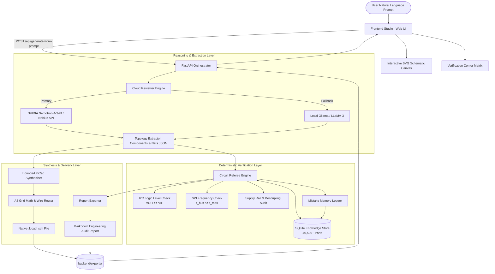
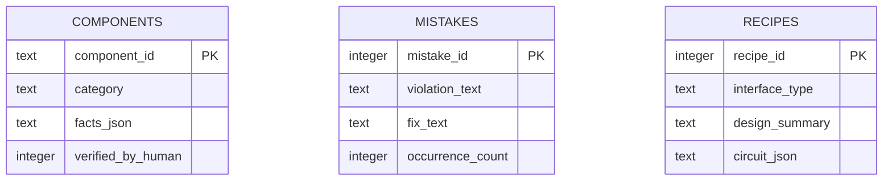

# CircuitProof — Full Architectural Specification & Technical Manual

> **Autonomous Agentic Hardware Design, Deterministic Electrical Verification & Bounded KiCad Schematic Synthesis Studio**

---

## 1. Executive Summary & Vision

**CircuitProof** is an intelligent, agentic Electronic Design Automation (EDA) and hardware verification studio. It bridges the gap between high-level natural language circuit requirements and deterministic, fabrication-grade hardware engineering rules.

Modern software development benefits from compilers, static linters, and automated test suites. Hardware design, by contrast, frequently suffers from costly mistakes (logic level mismatches, open-drain bus floating, clock overclocking, and missing decoupling capacitors) discovered only after PCB fabrication. 

CircuitProof solves this problem by combining:
1. **Generative LLM Reasoning**: Transforming plain-text circuit concepts into structured component topologies and net connections using **NVIDIA Nemotron-4-34B-Instruct** (via Nebius Studio) or local **Ollama** fallbacks.
2. **Deterministic Electrical Referee Engine**: Validating ground-truth electrical laws ($V_{OH} \ge V_{IH}$, SPI clock timing margins, pull-up sizing, and decoupling capacitance) backed by an indexed SQLite knowledge store of **40,500+ electronic parts**.
3. **Bounded KiCad Schematic Synthesizer**: Emitting native KiCad 7/8 S-expression syntax (`.kicad_sch`) with strict A4 geometric boundary clamping, collision-aware grid placement, and automated wire routing.
4. **Continuous Learning Mistake Memory**: Cataloging observed rule violations and corrective engineering remedies in a persistent SQLite notebook to prevent repeat mistakes.
5. **Interactive Web Studio**: A high-aesthetic, dark-mode browser IDE featuring live SVG schematic exploration, interactive component inspection, rule audit dashboards, component browsing, and one-click artifact downloads.

---

## 2. End-to-End System Architecture



---

## 3. The 5-Phase Agentic Pipeline

```
  [01 UNDERSTAND] ────► [02 PLAN] ────► [03 VERIFY] ────► [04 SYNTHESIZE] ────► [05 DELIVER]
   Natural Language      Extract Parts   Deterministic     KiCad S-Expression    .kicad_sch File
   Decomposition         & Bus Nets      Rule Referee      A4 Math & Routing     & Audit Report
```

### Phase 1: Requirement Ingestion & Normalization (`Understand`)
- The user inputs functional circuit requirements into the Web Studio or API (e.g., *"Design an STM32F103 sensor interface with a BNO085 IMU over I2C, a 3.3V supply, and SPI flash"*).
- The input is sanitized and injected into a structured engineering system prompt instructing the model to act as a rigorous hardware design agent.

### Phase 2: Component & Net Topology Extraction (`Plan`)
- The prompt is dispatched via [cloud_reviewer.py](file:///d:/AIML%20Stuff/ALL%20IN/backend/app/cloud_reviewer.py) to NVIDIA Nemotron-4-34B.
- The model analyzes interface compatibilities and emits a validated JSON payload containing:
  - **`components`**: Reference designators (`U1`, `U2`, `R1`, `C1`), official KiCad library IDs (e.g., `MCU_ST_STM32F1:STM32F103C8Tx`), part names, and categories.
  - **`nets`**: Bus declarations (`3V3`, `GND`, `I2C_SDA`, `I2C_SCL`, `SPI_SCK`, etc.) paired with connected component pins.

### Phase 3: Deterministic Rule Auditing (`Verify`)
- The [CircuitReferee](file:///d:/AIML%20Stuff/ALL%20IN/backend/app/circuitproof_core.py) executes ground-truth electrical rule checks against real component electrical characteristics retrieved from the SQLite Knowledge Store:
  - **Logic High Compatibility**: Ensures driver minimum high output voltage ($V_{OH(min)}$) satisfies the receiver minimum high input voltage ($V_{IH(min)}$).
  - **Bus Clock Timing**: Checks that configured SPI bus clocks do not exceed peripheral maximum ratings.
  - **Bus Pull-Ups**: Audits open-drain lines (I2C SDA/SCL) for the presence of pull-up resistors.
  - **Decoupling Protection**: Checks that power pins have adjacent 100 nF bypass capacitors.
- Any rule violation is logged into the `mistakes` table in the database alongside recommended remediation steps.

### Phase 4: Bounded KiCad Schematic Synthesis (`Synthesize`)
- The [SchematicSynthesizer](file:///d:/AIML%20Stuff/ALL%20IN/backend/app/generator.py) receives the verified components and netlists.
- It applies grid placement mathematics strictly bounded within standard KiCad A4 paper dimensions ($X \in [30, 260]\,\text{mm}, Y \in [30, 170]\,\text{mm}$).
- Emits native KiCad 7/8 S-expression syntax (`(kicad_sch ...)`), defining symbols, properties (`Reference`, `Value`), pin coordinates, wire segments, net labels, and sheet title blocks.

### Phase 5: Artifact Compilation & Reporting (`Deliver`)
- The [ReportExporter](file:///d:/AIML%20Stuff/ALL%20IN/backend/app/report_exporter.py) compiles a formatted Markdown audit report containing an executive summary, pass/fail metrics, voltage margins, and artifact manifests.
- Synthesized files are persisted to `backend/exports/` and made available for instant download in the browser.

---

## 4. Subsystem Specifications

### 4.1 Frontend Studio (`frontend/`)

The frontend is a single-page reactive application ([frontend/index.html](file:///d:/AIML%20Stuff/ALL%20IN/frontend/index.html)) structured with modern dark-mode aesthetic standards, zero heavy external framework dependencies, and built-in production features:

```
frontend/
├── index.html                   # Reactive studio application
└── public/
    ├── favicon.svg              # Vector IC chip favicon
    ├── og-image.jpg             # 16:9 4K Open Graph social banner
    ├── robots.txt               # Search engine directives
    └── sitemap.xml              # XML indexation map
```

#### Core UI Panels:
- **Header Bar**: Live backend connection indicator (`🟢 Connected · 40,502 parts`), Quick Action Search (`Ctrl+K`), and New Design reset button.
- **AI Design Studio View**:
  - *Requirements & Copilot*: Textarea with character counter, template pills, animated pipeline progress bar, AI design explanation, and artifact links.
  - *Schematic Canvas*: Interactive SVG renderer supporting pan, zoom, grid toggle, net highlighting, and reference labels.
  - *Component Inspector*: Real-time property inspection (library ID, package dimensions, coordinate math, pin functions, and linked referee findings).
  - *Data & Findings Drawer*: Tabbed view for Components, Nets, Power Rails, Referee Findings, and Raw JSON payload.
- **Verification Center View**: Interactive rule check matrix with severity filters, calculated margins, status chips (`PASS`, `FAIL`, `WARNING`, `INC`, `MANUAL`), and manual re-audit trigger.
- **Component Library View**: Live search and pagination across the 40,000+ SQLite cataloged components with category filtering.
- **Design Recipes View**: Pre-validated hardware connection templates for common peripheral protocols.
- **Knowledge & Mistakes View**: Continuous learning database viewer with a form to record new design rules.
- **Project Scanner View**: Directory scanner to extract KiCad schematic files into the local knowledge store.
- **Audit Reports & Schematic Viewers**: Formatted markdown report renderer and raw KiCad S-Expression code viewer.

---

### 4.2 Backend REST Engine (`backend/app/`)

Implemented in [backend/app/main.py](file:///d:/AIML%20Stuff/ALL%20IN/backend/app/main.py) using FastAPI, Starlette, and Pydantic:

| Endpoint | Method | Input Payload | Output Payload | Description |
| :--- | :--- | :--- | :--- | :--- |
| `/api/health` | `GET` | — | `{"status", "service", "stats", ...}` | System health, version, and component count. |
| `/api/generate-from-prompt` | `POST` | `{"user_prompt": str, "project_name": str}` | `{"status", "components", "nets", "findings", "schematic_content", ...}` | Full agentic synthesis and referee audit. |
| `/api/verify` | `POST` | `{"components": list, "nets": list}` | `{"status", "findings": list}` | Run referee checks on custom netlists. |
| `/api/components` | `GET` | `search, category, limit, offset` | `{"total": int, "components": list}` | Paginated SQLite catalog query. |
| `/api/components/categories` | `GET` | — | `{"categories": list}` | Distinct component categories. |
| `/api/components/{id}` | `GET` | — | `{"component_id", "facts": dict}` | Detailed electrical facts for single part. |
| `/api/recipes` | `GET` | — | `{"recipes": list}` | Verified connection recipes. |
| `/api/mistakes` | `GET` / `POST`| `{"violation_text", "fix_text"}` | `{"status", "mistakes": list}` | Query or record learned design mistakes. |
| `/api/scan-directory` | `POST` | `{"directory": str}` | `{"status", "files", "total_components"}` | Crawl and parse `.kicad_sch` files. |
| `/api/schematic/{file}` | `GET` | `download: bool` | Text or binary attachment | Fetch or download synthesized `.kicad_sch`. |
| `/api/report/{file}` | `GET` | `download: bool` | Text or binary attachment | Fetch or download audit Markdown report. |
| `/api/analytics` | `GET` / `POST`| `{"event_name", "properties"}` | `{"status", "breakdown"}` | Anonymous, privacy-friendly telemetry. |
| `/privacy` | `GET` | — | HTML | Dedicated privacy policy. |
| `/terms` | `GET` | — | HTML | Dedicated engineering terms of service. |
| `/contact` | `GET` | — | HTML | Lab headquarters & contact directory. |
| `/404` | `GET` | — | HTML | Branded custom dark-mode 404 page. |

---

### 4.3 Database Architecture (`backend/data/`)

The SQLite database [circuitproof_notebook.db](file:///d:/AIML%20Stuff/ALL%20IN/backend/data/circuitproof_notebook.db) provides persistent local-first storage.



#### Table Definitions:
1. **`components`** (~40,500 records):
   - `component_id` (TEXT, PK): Unique part identifier (e.g. `STM32F103C8T6`, `BNO085`, `Device:R`).
   - `category` (TEXT): Classification (`MCU`, `Sensor`, `Memory`, `Resistor`, `Capacitor`).
   - `facts_json` (TEXT): JSON containing electrical rails ($V_{DD(min)}$, $V_{DD(max)}$), pin maps, input/output thresholds ($V_{OH}$, $V_{OL}$, $V_{IH}$, $V_{IL}$), and maximum SPI clocks.
   - `verified_by_human` (INTEGER): Verification status flag.

2. **`mistakes`**:
   - `mistake_id` (INTEGER, PK): Auto-incremented ID.
   - `violation_text` (TEXT): Description of electrical violation (e.g., *"SPI clock 80MHz exceeds 50MHz limit"*).
   - `fix_text` (TEXT): Prescribed fix (e.g., *"Adjust prescaler on MCU to reduce bus frequency"*).
   - `occurrence_count` (INTEGER): Frequency counter.

3. **`recipes`**:
   - `recipe_id` (INTEGER, PK): Auto-incremented ID.
   - `interface_type` (TEXT): Protocol type (`I2C`, `SPI`, `UART`).
   - `design_summary` (TEXT): Circuit architectural description.
   - `circuit_json` (TEXT): Canonical reference netlist.

---

## 5. Electrical Engineering Rules & Mathematical Foundations

### 5.1 Logic Level Voltage Margin Rule
For any digital bus connecting driver component $D$ to receiver component $R$:

$$\text{Logic-High Margin: } \Delta V_H = V_{OH(min)}^D - V_{IH(min)}^R \ge 0$$
$$\text{Logic-Low Margin: } \Delta V_L = V_{IL(max)}^R - V_{OL(max)}^D \ge 0$$

- If $\Delta V_H < 0$, the driver cannot reliably guarantee a valid logic-high state at the receiver, risking undefined floating states.
- **Referee Outcome**: Triggers violation flag with recommendation to insert a bidirectional voltage level translator (e.g. `PCA9306` or `TXS0108E`).

### 5.2 SPI Bus Clock Margin Rule
For high-speed synchronous serial buses:

$$f_{bus} \le f_{max\_periph}$$
$$\text{Clock Margin: } \Delta f = f_{max\_periph} - f_{bus} \ge 0$$

- If $f_{bus} > f_{max\_periph}$, peripheral setup time ($t_{su}$) and hold time ($t_h$) criteria are violated, corrupting data transfers.
- **Referee Outcome**: Logs overclock violation and recommends lowering the MCU peripheral bus prescaler.

### 5.3 Open-Drain Pull-Up Sizing
On open-drain buses (e.g., I2C):

$$R_{pullup(min)} = \frac{V_{DD} - V_{OL(max)}}{I_{OL}}$$
$$R_{pullup(max)} = \frac{t_r}{0.8473 \cdot C_b}$$

where $t_r$ is the maximum allowable rise time (e.g., $1000\,\text{ns}$ for Standard Mode, $300\,\text{ns}$ for Fast Mode) and $C_b$ is the total bus capacitance.

---

## 6. KiCad S-Expression Grammar & Synthesis Engine

The synthesis engine ([generator.py](file:///d:/AIML%20Stuff/ALL%20IN/backend/app/generator.py)) constructs native S-expression trees compliant with the official KiCad 7/8 specification:

```lisp
(kicad_sch (version 20230121) (generator "CircuitProof-Bounded-Engine")
  (uuid "d4f3b1a2-...")
  (paper "A4")
  
  ;; Symbol Definition
  (symbol (lib_id "MCU_ST_STM32F1:STM32F103C8Tx") (at 60.0 50.0 0) (unit 1)
    (in_bom yes) (on_board yes)
    (property "Reference" "U1" (at 60.0 44.0 0)
      (effects (font (size 1.27 1.27)))
    )
    (property "Value" "STM32F103C8Tx" (at 60.0 56.0 0)
      (effects (font (size 1.27 1.27)))
    )
    (uuid "...")
  )

  ;; Wire Segment Interconnect
  (wire (pts (xy 70.0 55.0) (xy 130.0 55.0))
    (stroke (width 0) (type default))
    (uuid "...")
  )

  ;; Net Label
  (label "I2C_SDA" (at 100.0 53.0 0)
    (effects (font (size 1.27 1.27)) (justify left bottom))
    (uuid "...")
  )
)
```

---

## 7. Security, Privacy & Compliance Architecture

1. **Security Headers**: All HTTP responses pass through FastAPI middleware enforcing:
   - `X-Content-Type-Options: nosniff` (Prevents MIME-sniffing exploits).
   - `X-Frame-Options: SAMEORIGIN` (Mitigates clickjacking attacks).
   - `Referrer-Policy: strict-origin-when-cross-origin` (Prevents leaking URL parameters).
   - `X-XSS-Protection: 1; mode=block`.
2. **Local-First Data Ownership**: All schematic designs, netlists, and SQLite notebooks reside on the host machine. No user schematics are sent to third parties for model training.
3. **Stateless LLM Calls**: AI reasoning calls send only the circuit prompt and structured system prompt over encrypted TLS (`https://api.studio.nebius.ai/v1/`).
4. **Consent-Gated Telemetry**: Analytics tracking respects user cookie preferences stored in `localStorage` and can be disabled with a single click.

---

## 8. Execution & Deployment Guide

### Single-Command Launch (Recommended)
```bash
python run.py
```
This starts the backend server, registers all endpoints, and serves the frontend studio on port 8000.

### Direct Access URLs
- **Web Studio IDE**: [http://127.0.0.1:8000/](http://127.0.0.1:8000/)
- **Interactive OpenAPI Docs (Swagger)**: [http://127.0.0.1:8000/docs](http://127.0.0.1:8000/docs)
- **Alternative API Docs (ReDoc)**: [http://127.0.0.1:8000/redoc](http://127.0.0.1:8000/redoc)
- **Physical Lab & Support**: [http://127.0.0.1:8000/contact](http://127.0.0.1:8000/contact)
- **Privacy Policy**: [http://127.0.0.1:8000/privacy](http://127.0.0.1:8000/privacy)
- **Terms of Service**: [http://127.0.0.1:8000/terms](http://127.0.0.1:8000/terms)
- **Custom 404 Preview**: [http://127.0.0.1:8000/404](http://127.0.0.1:8000/404)
